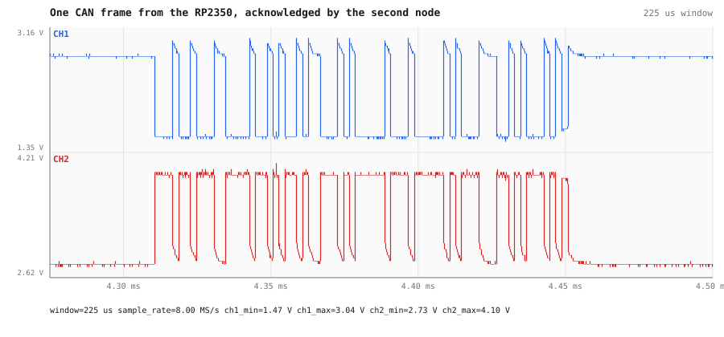
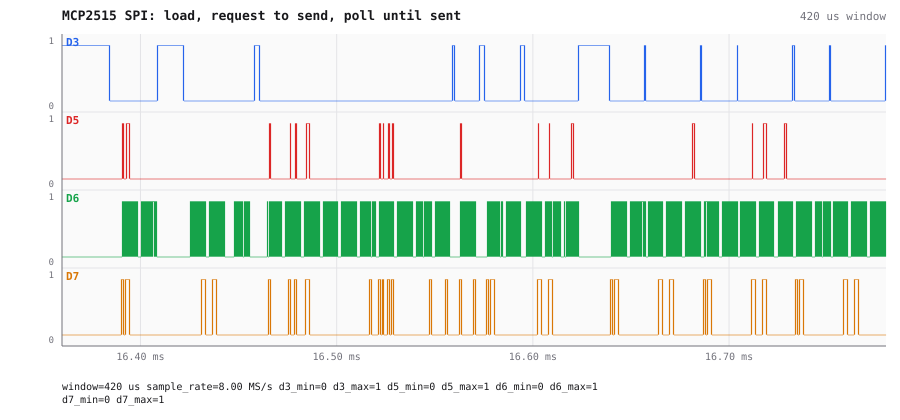
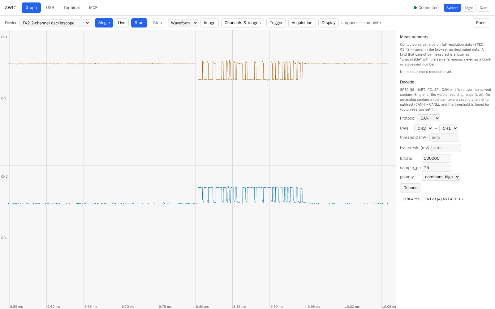
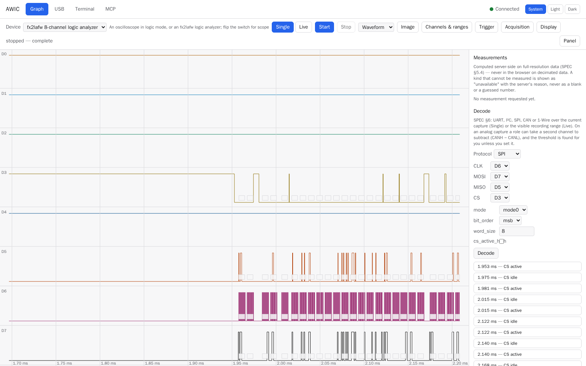
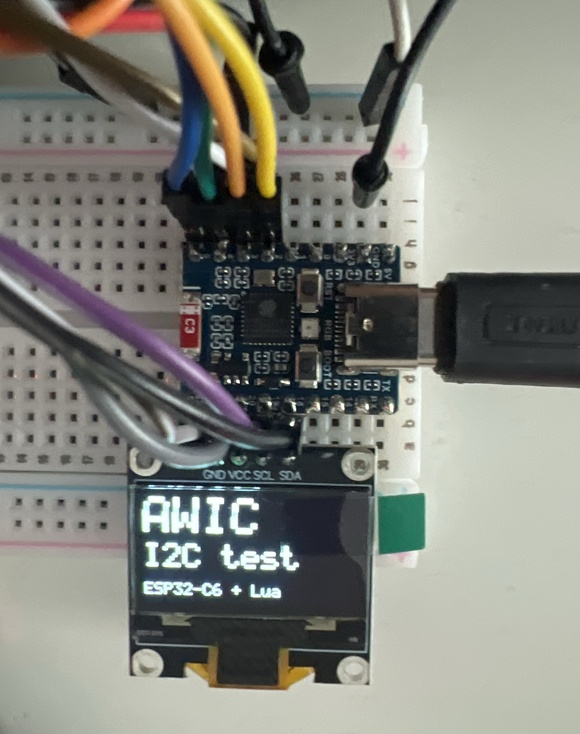
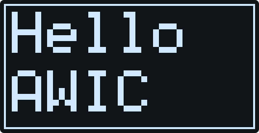
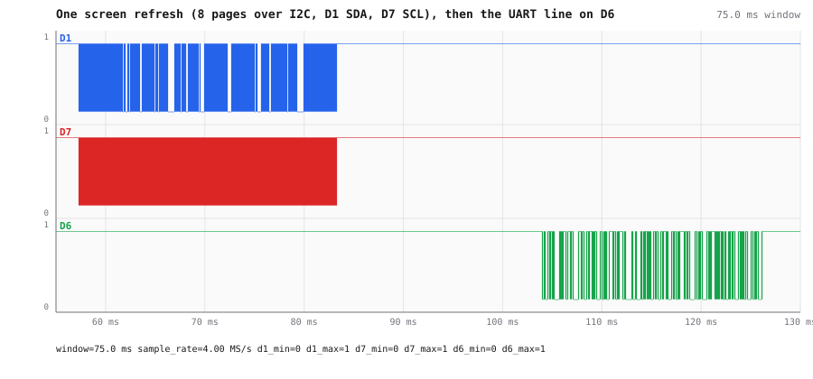
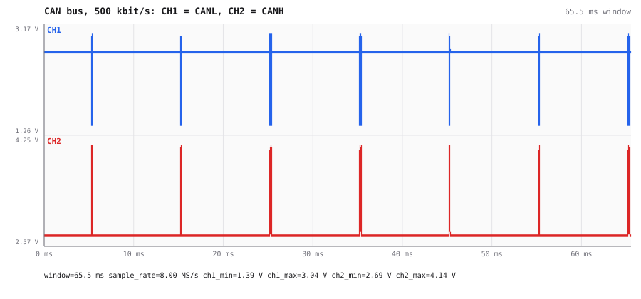

# Example reports

What an agent and a person learn from AWIC on a real bench. Every picture is a link to the report
it comes from. Waveform pictures are drawn by AWIC's own renderer (`render_view` over MCP,
`GET /api/render` in a browser); the screenshots show the web UI.

## CAN with two nodes — [can-two-nodes.md](can-two-nodes.md)

An RP2350 sends CAN frames through an MCP2515 controller; the scope watches the bus, the logic
analyzer the SPI lines to the controller. One frame, seen from both sides.

## A bit-banged UART next to a hardware one — [uart-bit-banged.md](uart-bit-banged.md)

Why one serial line decodes cleanly and the other drops a character now and then, told by the
histogram of bit lengths.

## An OLED display, read back from its I²C wires — [esp32-display.md](esp32-display.md)

An ESP32-C6 draws a screen; AWIC records the bus and rebuilds the picture from the bytes on the wire.

## CAN bus on the oscilloscope alone — [can-on-the-scope.md](can-on-the-scope.md)

A 500 kbit/s bus found and decoded from the scope's two probes, differential, with no transceiver.

## I²C display on the logic analyzer — [i2c-display.md](i2c-display.md)

One survey call names the I²C pair, one decode call reads the framebuffer an OLED is sent.

## A sine generator and the calibration output — [sine-and-calibration.md](sine-and-calibration.md)

An uncompensated 1:10 probe, and the oscilloscope dropping samples at 16 MS/s, shown with a sine.

## The USB tab — [usb-tab.md](usb-tab.md)

The bench as the server sees it, and which ports AWIC may switch.

## The MCP tab — [mcp-tab.md](mcp-tab.md)

Who is connected, and every request an agent made, with the pictures it was sent.

