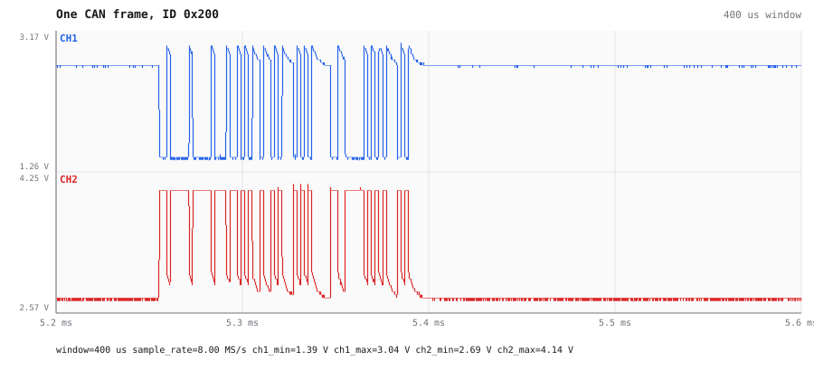

# CAN bus on the oscilloscope

On 2026-10-04 an agent (Claude Code over MCP, 27 tools) was given a bench it had not seen and asked what is on it. The pictures come from AWIC's own renderer (`render_view`, `GET /api/render`), re-rendered after the fixes listed at the end.

The scope's two probes sat on an unknown pair of lines. AWIC found a CAN bus on them and decoded it
from the analog samples alone, with no transceiver and no logic analyzer.

| Instrument | Lines | What is there |
|---|---|---|
| FX2 oscilloscope (`3-3.4.2`), 8 MS/s, 5 V range | CH1, CH2 | **CAN bus, 500 kbit/s**: CH1 = CANL, CH2 = CANH. A frame every 10 ms, IDs `0x7FF`, `0x100`, `0x200`, `0x123`, payload counting up. **No frame is ACKed.** |

## How the agent got there

1. `configure_acquisition` + `capture` on the scope at the 2.5 V range came back flat at exactly
   2.50 V on CH2, with `vpp = 0`, and every reading now says why: `clipped: every sample on the
   converter's top code (+2.50 V) — the signal goes past this range … Capture at a larger range`
   (CH1, which dips to 1.4 V, is 99.2 % clipped and says so too). The same capture at the **5 V**
   range gives CH1 1.39…3.04 V and CH2 2.69…4.14 V, both around 2.6 kHz, and carries no such note.
   Those are the recessive (~2.7 V) and dominant levels of a CAN pair.
2. `decode` with `{"role":"can","channel":1,"minus":0}` decodes CANH − CANL as one differential line.
   It takes `bitrate:"auto"` and `polarity:"dominant_high"`, and reports
   `detected_baud: 500000` and the threshold it picked (`CH2-CH1 threshold 1.312 V, hysteresis 0.526 V`):

   | t | ID | DLC | data | ACK |
   |---|---|---|---|---|
   | 5.26 ms | `0x200` | 4 | `AD AE AF B0` | **no** |
   | 15.20 ms | `0x123` | 2 | `AE AF` | **no** |
   | 25.19 ms | `0x7FF` | 8 | `AF B0 B1 B2 B3 B4 B5 B6` | **no** |
   | 35.22 ms | `0x100` | 8 | `B0 B1 B2 B3 B4 B5 B6 B7` | **no** |
   | 45.19 ms | `0x200` | 4 | `B1 B2 B3 B4` | **no** |
   | 55.23 ms | `0x123` | 2 | `B2 B3` | **no** |
   | 65.20 ms | `0x7FF` | 8 | `B3 B4 B5 B6 B7 B8 B9 BA` | **no** |

   Seven frames in 65.5 ms, one every 10 ms. The first data byte increments by one per frame. **No
   node acknowledges them**, so the transmitter is alone on the bus — the CANable2 *is* the
   transmitter, and nothing else on the bench speaks CAN.

## What the views show

Seven CAN frames on CANL (CH1) and CANH (CH2), one every 10 ms:

One frame zoomed in. The two lines mirror each other around ~2.7 V:

The eye of CANH over the same capture recovers the bit time from the shortest run between
crossings — 1.9985 µs, 500.4 kbit/s — and reports 1.33 µs of TIE against a grid of whole bit
times, most of it the 10 ms idle gaps between frames (`jitter_cycle_to_cycle_pp` is 20 ns). The
report leaves the eye picture itself out; the numbers are the point.
