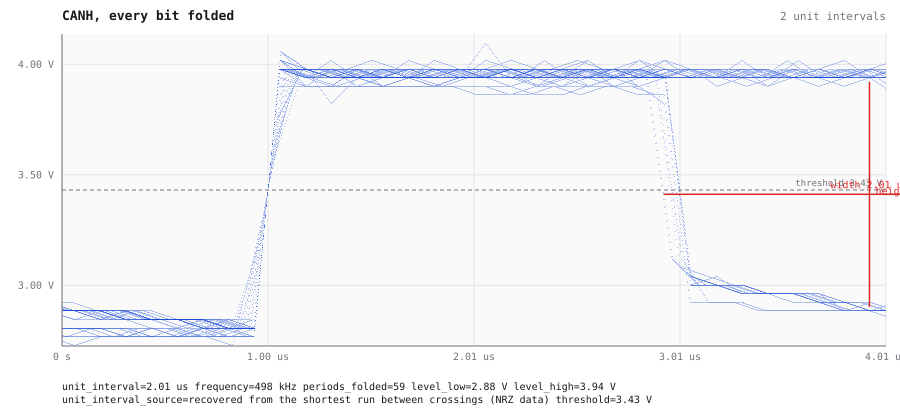
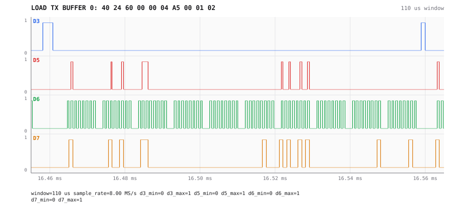

# CAN with two nodes: one frame, seen from both sides of the controller

An RP2350 board drives an MCP2515 CAN controller over SPI and sends a frame every ~10 ms; a USB CAN
adapter on the same bus acknowledges them. AWIC watches both sides at once: the oscilloscope on
the bus wires (CH1 = CANL, CH2 = CANH), the logic analyzer on the SPI lines between the
microcontroller and the controller. Recorded on 2026-10-11, driven by an agent over MCP; the board
was programmed in Lua through a second MCP server on the same machine.

## How the wiring was found

Nothing was labelled. With the board idle, `survey_channels` on the logic analyzer reported every
line constant. With the board sending, the same call answered in one go:

```
D3  SPI chip select, active low (clock on D6)
D5  active, rests low, 3162 edges, bursts every 10.570 ms
D6  SPI clock, mode 0 (data on D7, CS on D3)
D7  SPI data, MOSI or MISO (clock on D6, mode 0)
guess {"protocol":"spi","clk":6,"cs":3,"data":[7],"mode":0}
```

Which data line is MOSI cannot be told from timing, and the survey says so. The decoded bytes tell:
the line carrying `03`, `40`, `81` — the MCP2515's READ, LOAD TX BUFFER and RTS opcodes — is the
microcontroller's output, so **D7 is MOSI and D5 is MISO**.

## The bus: frames, now acknowledged

`decode` on the scope capture, CANH − CANL as one differential line (`{"role":"can","channel":1,"minus":0}`,
`bitrate: "auto"`, `polarity: "dominant_high"`):

| t | ID | DLC | data | ACK |
|---|---|---|---|---|
| 4.311 ms | `0x123` | 4 | `A5 8A 01 02` | yes |
| 14.892 ms | `0x123` | 4 | `A5 8B 01 02` | yes |
| 25.467 ms | `0x123` | 4 | `A5 8C 01 02` | yes |

`detected_baud: 500000`, a frame every 10.58 ms (the program's 10 ms sleep plus the send), the
counter in the second byte. The decoder cut the difference at the standard 0.7 V threshold of
ISO 11898-2 and says why it did not take the midpoint between the two levels. Every frame is
acknowledged: unlike the [single-node bus](can-on-the-scope.md), a second node is listening.


The eye of CANH over the whole capture recovers the bit time from the data — 2.01 µs, 498 kbit/s —
with 1.02 V of vertical opening and 130 ns of time interval error (6.5 % of a bit), fitted per
burst so the idle gaps between frames do not count as jitter:



## The SPI side: what it takes to send one frame

The analyzer, triggered on chip select, shows the microcontroller's whole conversation with the
controller for one frame (`decode`, SPI, `format: "transactions"`):

| t | MOSI | MISO | meaning |
|---|---|---|---|
| 16.384 ms | `B0 00` | `B0 00` | RX STATUS: nothing received (`00`) |
| 16.422 ms | `03 30 00` | `00 00 00` | READ TXB0CTRL: buffer free |
| 16.461 ms | `40 24 60 00 00 04 A5 00 01 02` | `40 04 60 00 00 00 A5 00 00 00` | LOAD TX BUFFER 0: ID `0x123` (`24 60`), DLC 4, data |
| 16.560 ms | `81` | `80` | RTS: request to send buffer 0 |
| 16.596 ms | `03 30 00` | `02 20 08` | TXREQ (`08`) set: frame queued |
| 16.657 ms | `03 30 00` | `00 00 08` | still sending |
| 16.704 ms | `03 30 00` | `02 30 08` | still sending |
| 16.752 ms | `03 30 00` | `00 00 00` | TXREQ clear: frame sent |

The controller does not answer during a write, so what MISO carries then is not data: it follows
MOSI with bits missing, which looks like crosstalk between the neighbouring wires.

From RTS to TXREQ clearing takes about 190 µs, and the frame itself is 156 µs on the scope: the rest
is the controller waiting for the bus and the microcontroller's polling interval.


Zoomed to the load command, every byte of the frame is on MOSI (D7):



## In the web UI

The scope in the Graph tab, triggered on CH2 rising at 3.4 V, with CAN decoded from CH2 − CH1. The
result list shows the frame's ID, length and data:


The logic analyzer, triggered on D3 falling, with SPI decoded (CLK D6, MOSI D7, MISO D5, CS D3).
The result list shows the chip-select edges rather than the bytes:


