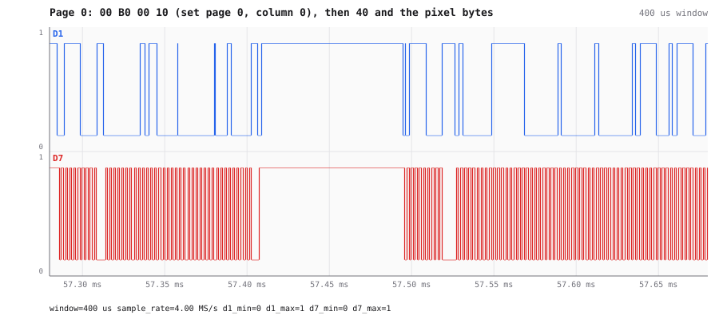
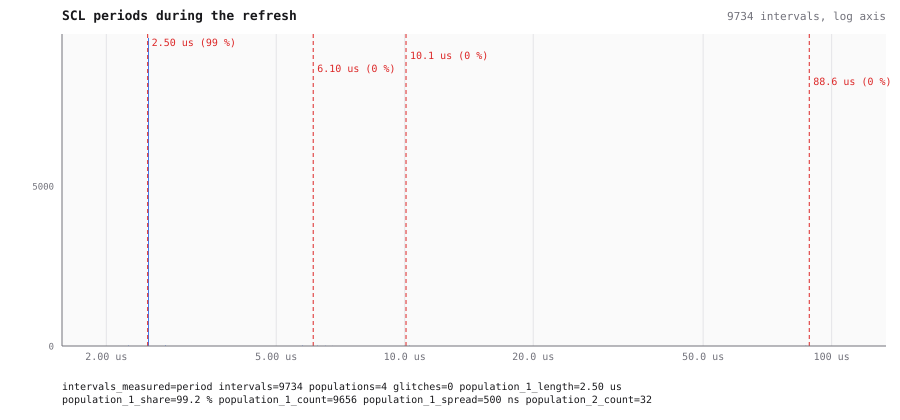

# An OLED display, read back from its I²C wires

An ESP32-C6 board with a 128×64 OLED on I²C and a serial line to a USB UART adapter. A program
written in Lua (through a second MCP server on the same machine) draws a screen and reports over
the serial line; AWIC records the logic analyzer's lines and reads the screen back from the
bytes on the wire. Recorded on 2026-10-11.


## What is wired where

One `survey_channels` call on the logic analyzer, with the board drawing and the adapter sending:

```
D1  I2C SDA (clock on D7)
D4  UART at 115200 baud (idles high)
D6  active, rests high, 496 edges, 14 bursts
D7  I2C SCL (data on D1) at ~400.000 kHz, 128 transactions
```

D4 is the adapter's transmitter, at 115200 baud. D6 is the board's: the Lua program bit-bangs
9600 baud. The survey did not call that line a UART when this was recorded; it does now (see
[the UART report](uart-bit-banged.md)).

## Recording instead of triggering

A triggered capture is the obvious way to catch one screen update, but the board and the analyzer
are driven by two different tools, and the update came and went before the capture was armed.
So AWIC recorded instead: `start_recording` on D1, D4, D6 and D7 at 4 MS/s, then the test, then
`decode` straight on the recording. Its first 25 seconds on four lines took 324 KB, compressed 310:1. The
recording also shows one of its own features: the analyzer stalled once, the recording resumed
after the driver reset it, and every result over that span says so (`recording 1 has no data in
8.378-11.659 s`).

## The screen, rebuilt from the I²C bytes

`decode` (I²C, SCL D7, SDA D1, `format: "transactions"`) over the recording found two refreshes
to address `0x3C`, 16 transactions each, no NACK: the program first clears the screen, then
draws it. Each page of the display is two transactions:

| t | data | meaning (SSD1306) |
|---|---|---|
| 57.285 ms | `00 B0 00 10` | command: page 0, column 0 |
| 57.494 ms | `40 FF 01 01 01 F1 F1 F1 01 …` (129 bytes) | data: 128 columns of 8 pixels |
| 60.544 ms | `00 B1 00 10` | command: page 1, column 0 |
| … | … | eight pages in all |

Laying the eight pages' bytes side by side, one bit per pixel, gives back what the program drew
— the frame, "Hello" and "AWIC" — from nothing but the captured bus traffic:


The refresh takes 26 ms, 2.97 ms per page; then the board reports on the serial line:


One page, zoomed in: the 4-byte command, a stop, and the start of the 129-byte data write:



SCL runs at 400 kHz: 99.2 % of its periods are 2.50 µs. The rest are 10.1 µs pauses, one per
transaction:



## The serial lines

Over the same recording, `decode` (UART) reads both directions:

- D4, the adapter, `baud: "auto"` → 115200, no errors: `draw: Hello AWIC\r\n`, `status?\r\n`.
- D6, the board, `baud: 9600`: `P\xB1\x85\xE5 Hello AWIC\r\n` — the line was `display: Hello AWIC`.
  The first characters, sent right after the display update, come out wrong; the rest is clean.
  The [UART report](uart-bit-banged.md) shows where such errors come from in a bit-banged line.
