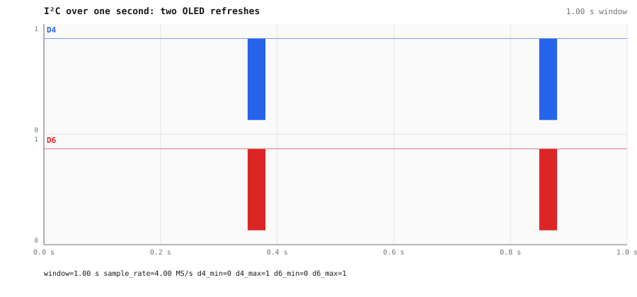
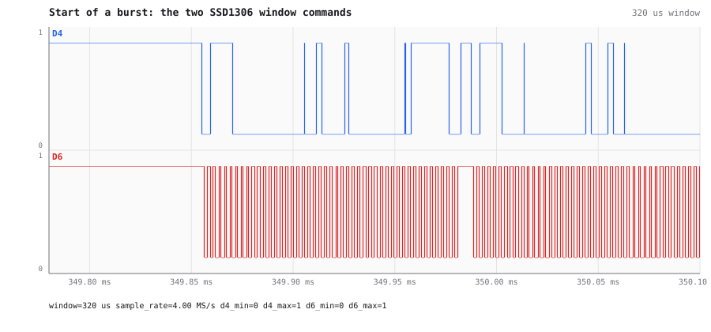
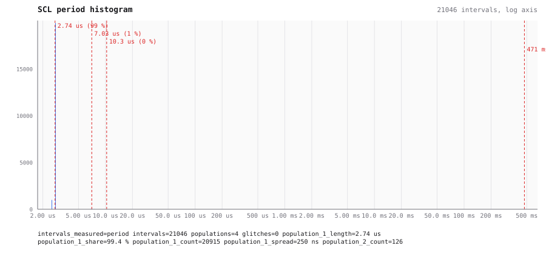

# I²C display on the logic analyzer

On 2026-10-04 an agent (Claude Code over MCP, 27 tools) was given a bench it had not seen and asked what is on it. The pictures come from AWIC's own renderer (`render_view`, `GET /api/render`), re-rendered after the fixes listed at the end.

Eight analyzer lines on an unknown board. One survey call named the I²C pair; one decode call read
what the board writes to its OLED.

| Instrument | Lines | What is there |
|---|---|---|
| fx2lafw logic analyzer (`3-3.4.1.1`), 4 MS/s | D4, D6 | **I²C, ~364 kHz**: D6 = SCL, D4 = SDA. All writes go to address **`0x3C`** (an SSD1306-style 128×64 OLED). Every write is ACKed. |
| | D0, D1, D5, D7 | constant low |
| | D2, D3 | constant high (idle, or pulled up) |

## How the agent got there

1. `list_instruments` returns two instruments, both `ready`. The scope offers 16 MHz…100 kHz and
   ranges of 5/2.5/1.25/0.5 V. The logic analyzer has 8 channels at up to 24 MHz.
2. `survey_channels {"device":"3-3.4.1.1"}` captures one second on all eight digital lines and
   names them in a single answer:
   `D6: "I2C SCL (data on D4) at ~363.636 kHz, 132 transactions"`, `D4: "I2C SDA (clock on D6)"`,
   and every other line constant. Its `guesses` entry,
   `{"protocol":"i2c","scl":6,"sda":4,"clock_hz":363636}`, is all `decode` needs.
3. `decode` (i2c, transactions) gives:

   | t | addr | data | meaning (SSD1306) |
   |---|---|---|---|
   | 349.855 ms | `0x3C` W | `00 21 00 7F` | command: column address 0…127 |
   | 349.987 ms | `0x3C` W | `00 22 00 07` | command: page address 0…7 |
   | 350.121 ms … | `0x3C` W | `40` + 16 bytes, ×64 | data: framebuffer, 1 KiB |

   There were 132 transactions in two bursts (at 349.855 ms and 849.876 ms), each burst a full
   screen refresh, with no NACKs and no errors.

## What the views show

The logic analyzer over one second: two bursts of I²C, each one a full OLED refresh:

The start of a burst: the two SSD1306 commands that set the column and page window:

The SCL period histogram. 99.4 % of periods are 2.74 µs (365 kHz) — 20 915 of 21 046 intervals.
The longer populations are the gaps between bytes and transactions, and none of them is a glitch:

