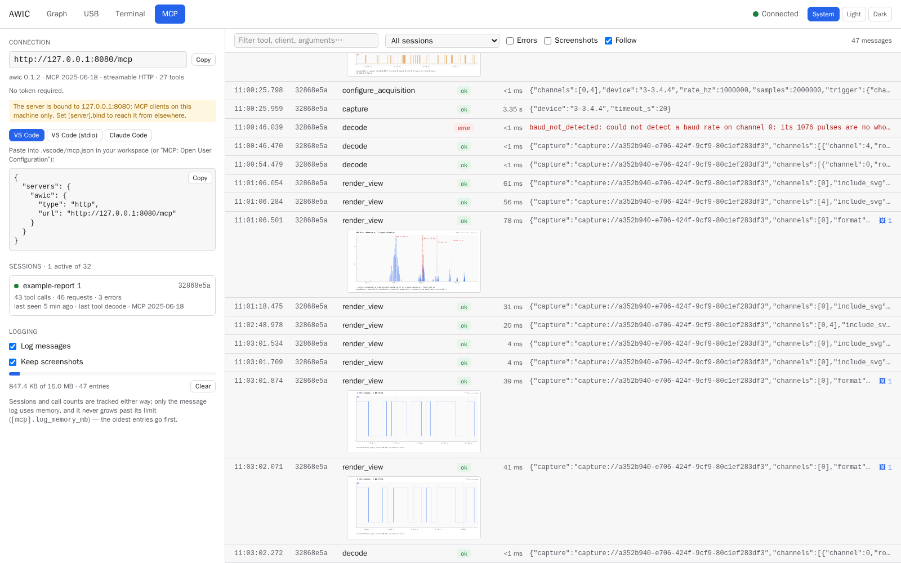
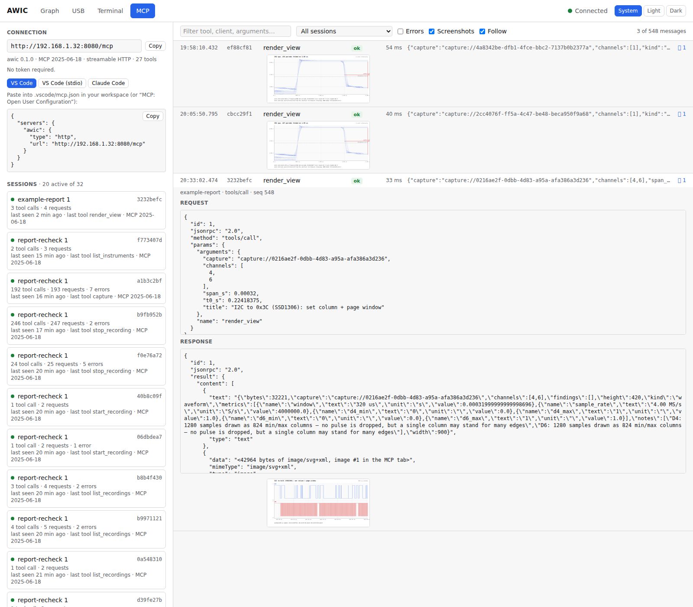

# The MCP tab

The tab during the 2026-10-11 bench run: one agent session (`example-report`, 43 tool calls,
3 errors), and its log. Each `render_view` row carries a thumbnail of the picture the agent was
sent; the red `decode` row is the automatic baud detection refusing the bit-banged UART line of
the [UART report](uart-bit-banged.md). Above the connection snippet, a note says the server is
bound to 127.0.0.1 and how to reach it from elsewhere.

## A render_view entry opened

From an earlier session (2026-10-04): with the **Screenshots** filter on and a `render_view` entry
opened, the log shows the JSON-RPC request, the metrics, and the picture the agent was sent.

