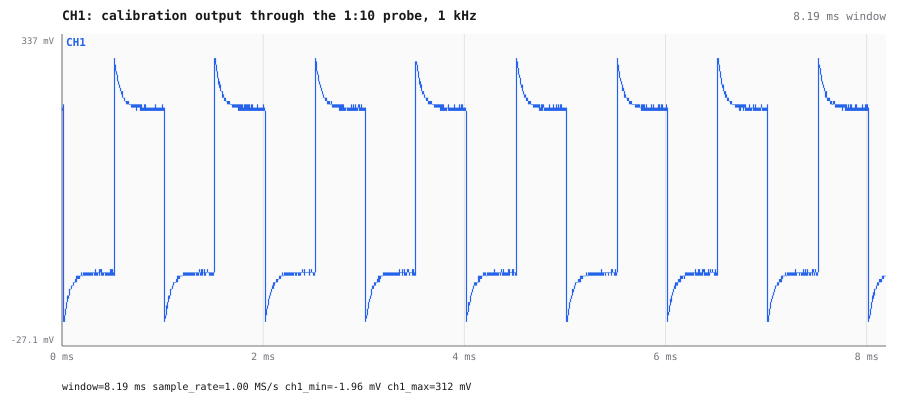
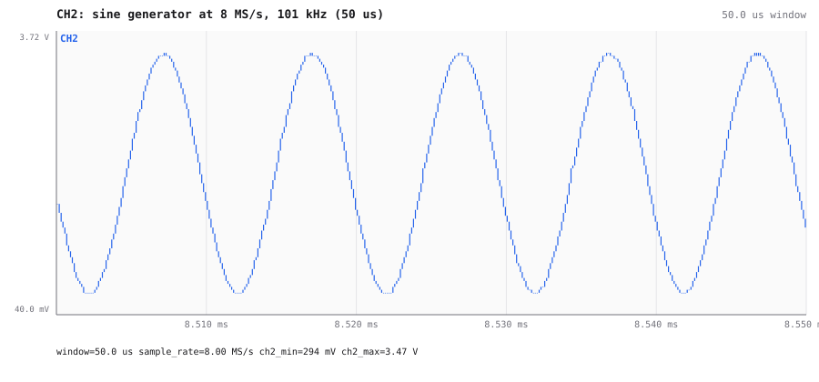
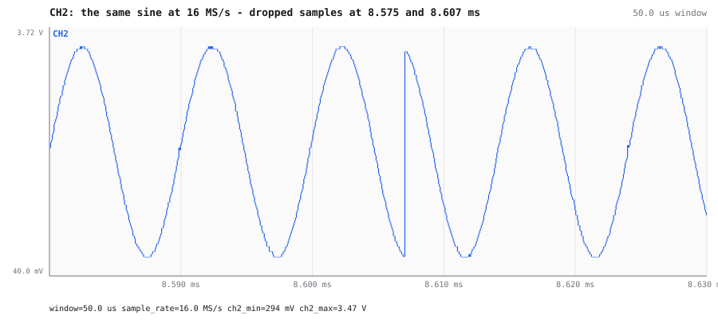
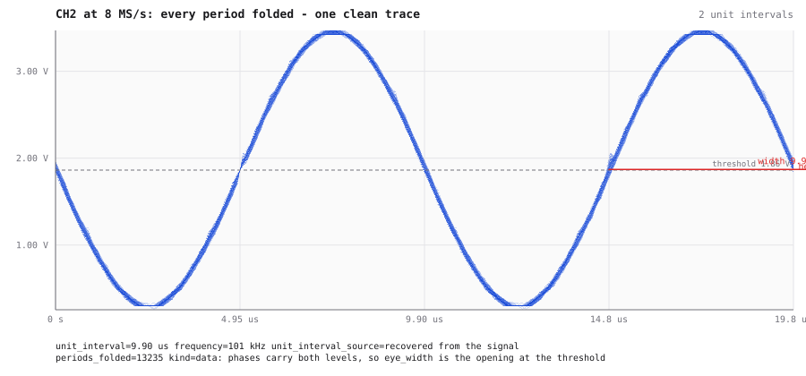
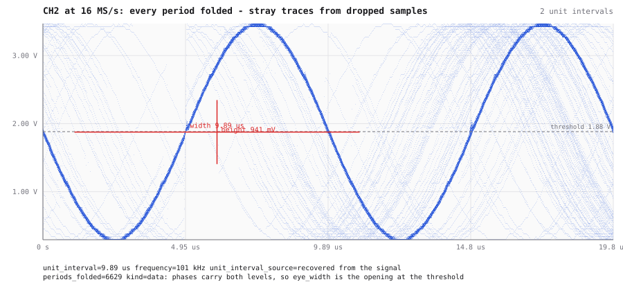

# A sine generator and the calibration output

Later on 2026-10-04 the scope's probes were moved to the oscilloscope's own calibration output and
a cheap sine generator. Pictures from AWIC's renderer.

Later the same evening, the scope's probes were moved:

| Channel | Signal | Measured |
|---|---|---|
| CH1 | the oscilloscope's own **calibration output**, through a 1:10 probe | 1 kHz square (1000.00 Hz), 50.0 % duty, 0 → 0.31 V at the 0.5 V range: about 3.1 V at the source |
| CH2 | a cheap **sine generator** | 101 kHz (100 988 Hz), 3.2 V p-p between 0.29 and 3.47 V, at the 5 V range |

The calibration square drawn by the server at 1 MS/s. Every edge overshoots and then settles over
about 0.1 ms. That is the signature of a **1:10 probe that is not compensated**: turn the trimmer
on the probe until the corners are square. The edges themselves are faster than the scope can
resolve (under one sample even at 16 MS/s).

### The glitches on the sine are dropped samples at 16 MS/s, not the generator

Glitches were visible on the sine in the web UI. The question was whether the cheap generator makes
them. The same sine was captured at four rates (1 M samples each), and every pair of neighbouring
samples was compared. At 8 MS/s a clean 3.2 V p-p, 101 kHz sine moves at most ~0.13 V from one
sample to the next, so a larger jump is a glitch:

| Rate | Jumps larger than the sine allows | Frequency the scope measures |
|---|---|---|
| 1 MS/s | – | 100 988 Hz |
| 4 MS/s | 0 in 1 048 576 samples | 100 988 Hz |
| 8 MS/s | 0 in 1 048 576 samples | 100 988 Hz |
| **16 MS/s** | **66 in 1 048 576 samples** (about one per ms, up to 3.1 V) | **101 168 Hz** (0.18 % high) |

At 16 MS/s, the trace jumps backwards in phase: a run of samples is missing, and the trace
continues as if no time had passed. The missing samples also make the sine look 0.18 % fast. The
generator is clean at every rate the scope can capture without losing data.

The same 50 µs of sine at 8 MS/s and at 16 MS/s:

The eye view folds every period onto the same axes. At 8 MS/s 13 235 periods give one clean trace
(TIE 117 ns, under one sample). At 16 MS/s the slips scatter into stray traces (TIE 31 µs):

The cause is still open.
The sine is the better test signal for it than CAN: every lost sample shows. Until it is fixed,
8 MS/s is the oscilloscope's safe rate.

Partway through, the sine generator was switched off or disconnected (CH2 then reads a flat 0.29 V).
The sine captures used here were all taken before that, and each one was checked for its 3.2 V
p-p before it was used.

