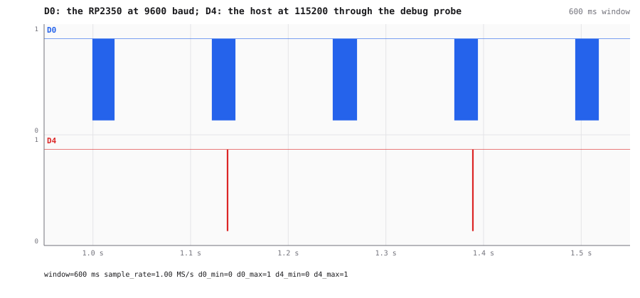
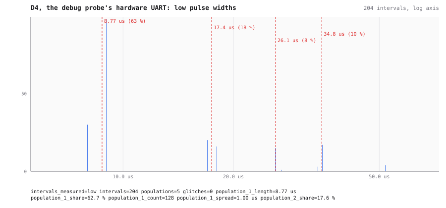
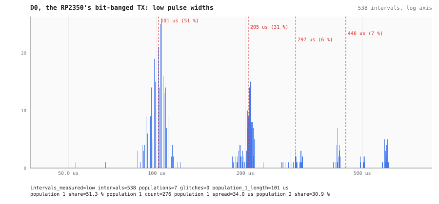
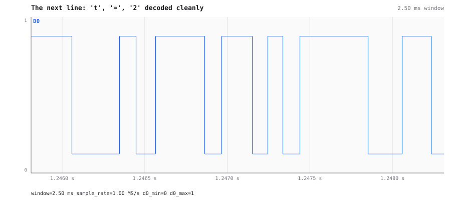
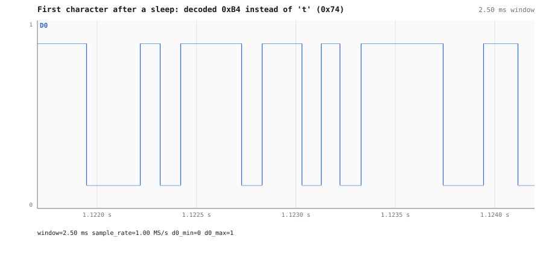
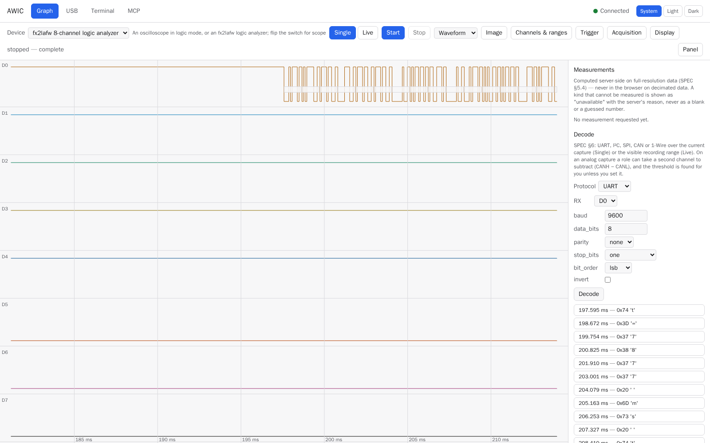
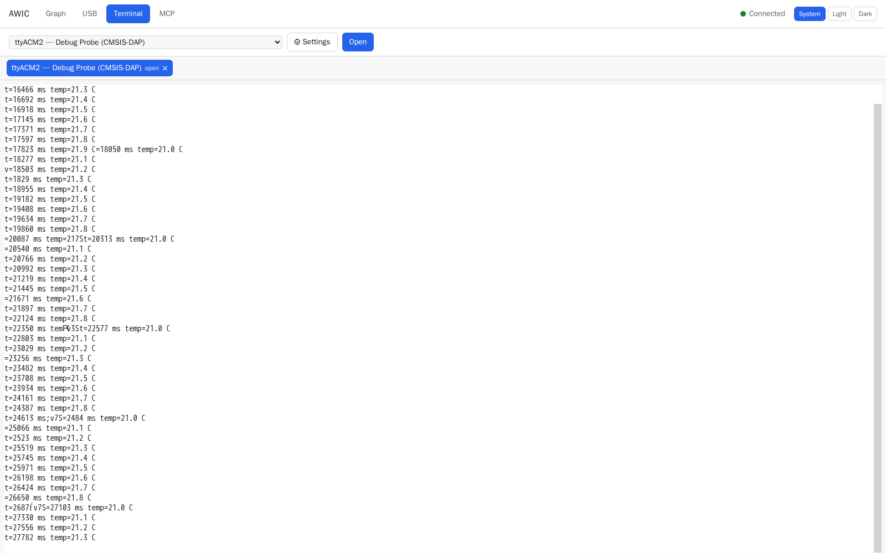

# A bit-banged UART next to a hardware one

The same RP2350 board talks to a debug probe over a serial line in both directions. The probe's
transmitter is a hardware UART at 115200 baud. The board's is not: the program runs in Lua, which
has no UART, so it bit-bangs 9600 baud on a GPIO, waiting out each 104 µs bit in a busy loop. The
logic analyzer sees both lines (D0 = the board's TX, D4 = the probe's TX). Recorded on 2026-10-11
over MCP.

## How the lines were found

Writing text to the probe's serial port while `survey_channels` ran named D4 at once:
`UART at 115200 baud (idles high)`. Watching the board's pins as inputs during the same traffic
showed which one follows it (GP1, the board's RX). The board's TX was confirmed the other way
round: bit-banged text on GP0 arrived at the probe's serial port, and on analyzer D0.

600 ms of both lines: the board's 9600-baud lines (D0) take about 22 ms each, the host's commands
at 115200 baud (D4) under a millisecond:



## The two sides decode differently

One 2-second capture at 1 MS/s, both lines, triggered on D0.

**D4, the probe**: `decode` with `baud: "auto"` finds `detected_baud: 115200` and reads every
line the host sent, without an error:

```
137.10 ms  led on\r\n
388.20 ms  status?\r\n
637.95 ms  led on\r\n
```

**D0, the board**: `baud: "auto"` was refused when this was recorded — `its 1076 pulses are no
whole number of one bit time` (fixed since, see below). With `baud: 9600` given, the text comes
out, with 5 errors in 9 lines, nearly all on the first character of a line:

```
1121.95 ms  \xB4=123 ms temp=21.1 C\r\n
1246.06 ms  t=247 ms temp=21.2 C\r\n
1370.15 ms  t=371 ms temp=21.3 C\r\n
1494.22 ms  p=495 ms temp=21.4 C\r\n
```

## Why: the histogram of bit lengths

The histogram of low pulse widths answers it in two pictures. The probe's pulses fall into five
narrow populations — 1, 2, 3, 4 and 6 bits of 8.77 µs — each spread over a single sample:



The board's single bit is 101 µs, but spread from 86 to 120 µs (±17 %), the longer runs spread
wider still, and there are two pulses of 53 and 67 µs that fit no bit count at all:



A receiver samples each bit in its middle, so ±17 % on single pulses still decodes; the probe
received the board's text. AWIC's automatic baud detection, which wanted every pulse within 0.2 bit
of a whole number, gave up on it — wrongly, since the line is receivable. It now judges the line
by its low runs, which are always whole bits, and finds 9600; the survey names the line a UART and
the anomaly view reads it as bits.

## The garbled first character

The second line should start with `t` (`0x74`), whose first three bits — start, bit 0, bit 1 — are
all low. On a clean line that first low run is about 300 µs:



On the garbled line it is about 270 µs: the start bit began late, because the first API call after
the program's sleep runs slow, while the timing of the following bits was taken before it. The
receiver's grid shifts and it reads `0xB4`. The probe received the same wrong byte, so this is the
transmitter, not the decoder:



## In the web UI

The Graph tab, triggered on D0 falling, with UART decoded at 9600 baud: each character with its time.



The Terminal tab with the probe's serial port open at 9600 baud: the board's lines as they arrive,
including the occasional character the bit-banged timing loses.


