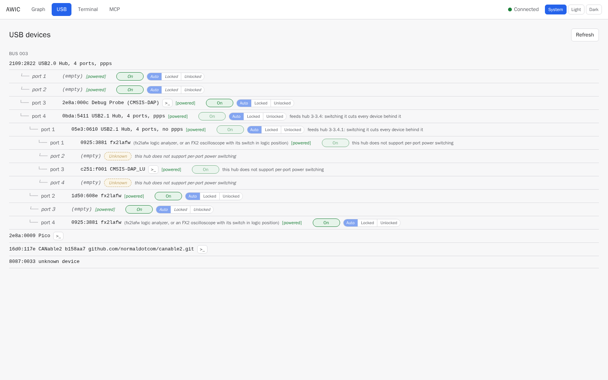

# The USB tab: what is on the bench, and which ports may be switched

The USB tab is the bench as the server sees it: every hub and device, what each port feeds, and
whether AWIC may switch it. Taken on 2026-10-11 with the bench of the
[CAN](can-two-nodes.md) and [UART](uart-bit-banged.md) reports attached.

What it shows here:

- Two **logic analyzers** (`0925:3881`), one behind a hub without per-port power switching, and
  the **oscilloscope** (`1d50:608e`, already running AWIC's firmware) on a switchable port.
  Instruments are told apart by their place in the tree, never by their ID: the two analyzers
  have the same one.
- A **debug probe** and a second CMSIS-DAP adapter, each with a serial port: the `>_` button opens
  it in the Terminal tab.
- Ports that feed a hub are **locked** ("feeds hub 3-3.4: switching it cuts every device behind
  it") — derived from what is attached, not configured. A port can be locked or unlocked by hand
  (Auto / Locked / Unlocked); the choice is kept across restarts.
- Ports on a hub that cannot switch power individually say so instead of offering a switch that
  would do nothing.
- Devices plugged straight into the computer (the RP2350 board, the USB CAN adapter) are listed
  below the tree, without a switch: they hang off a root port.

An agent sees the same tree through MCP `usb_tree`, and switches a port with `set_usb_power` or
`power_cycle_usb_port` — refused on a locked port, exactly as in the UI.
